# BÁO CÁO ĐỒ ÁN MÔN HỌC – TEXTSENSE

---

## PHẦN MỞ ĐẦU

### Thông tin học thuật
- **Trường / Khoa / Bộ môn:** ................................................................................
- **Môn học:** Khoa học dữ liệu ứng dụng (THU088)
- **Lớp:** 23QLTT
- **Tên đề tài:** **TextSense – Phát hiện bình luận tiêu cực trên mạng xã hội bằng phương pháp học máy**
- **Sinh viên thực hiện:** ................................................................................
- **Giảng viên hướng dẫn:** ................................................................................
- **Thời gian:** 2026

### Lời cam đoan
Tôi xin cam đoan toàn bộ nội dung, mã nguồn, số liệu thực nghiệm, biểu đồ và kết quả kiểm thử trình bày trong báo cáo này là sản phẩm nghiên cứu, cài đặt và kiểm chứng trung thực của cá nhân trong khuôn khổ đồ án môn học Khoa học dữ liệu ứng dụng. Mọi số liệu đều được truy xuất trực tiếp từ các tệp kết quả và nhật ký thực thi trong repository dự án TextSense.

### Lời cảm ơn
Xin chân thành cảm ơn Giảng viên hướng dẫn đã tận tình định hướng phương pháp nghiên cứu, kiểm toán quy trình thực nghiệm và góp ý chuyên môn để hoàn thiện hệ thống và báo cáo đồ án TextSense.

### Mục lục
[[WORD_TOC]]

### Danh mục hình
- Hình 2.1: Phân bố nhãn gốc (-1, 0, 1) trên dữ liệu nguồn (`binary_original_label_distribution.png`)
- Hình 2.2: Phân bố nhãn nhị phân (0 = Không tiêu cực, 1 = Tiêu cực) (`binary_label_distribution.png`)
- Hình 2.3: Phân bố số lượng bình luận theo nguồn Twitter và Reddit (`binary_source_distribution.png`)
- Hình 2.4: Phân bố độ dài văn bản theo số từ (`binary_text_length_distribution.png`)
- Hình 2.5: Top 20 từ xuất hiện nhiều nhất trong tập dữ liệu (`binary_top20_terms.png`)
- Hình 3.1: Sơ đồ pipeline huấn luyện và đánh giá chống rò rỉ dữ liệu (`fig_pipeline_architecture.png`)
- Hình 4.1: So sánh các mô hình phân loại trên tập Test (`binary_model_comparison.png`)
- Hình 4.2: Đường cong Precision–Recall của các mô hình trên tập Test (`binary_pr_curve.png`)
- Hình 4.3: Ma trận nhầm lẫn của LinearSVC trên tập Test (`binary_confusion_matrix.png`)
- Hình 4.4: So sánh F1-score trên T1 (Chính trị) và T2 (Đời thường) của 14 cấu hình (`fig3_t1_vs_t2_14models.png`)
- Hình 4.5: Đường cong đánh đổi liên miền E6 theo quy mô dữ liệu Sentiment140 (`fig4_e6_learning_curve.png`)
- Hình 5.1: Kiến trúc ứng dụng 3 tầng và luồng xử lý hệ thống TextSense (`fig_system_architecture.png`)
- Hình 5.2: Minh họa giao diện TextSense – Phân tích bình luận đơn lẻ (`fig_ui_single_analysis.png`)
- Hình 5.3: Minh họa giao diện TextSense – Phân tích hàng loạt và thống kê mô hình (`fig_ui_batch_dashboard.png`)

### Danh mục bảng
- Bảng 2.1: Tổng hợp phân bố nhãn gốc và nhãn nhị phân theo nguồn dữ liệu
- Bảng 2.2: Quy trình làm sạch và loại rò rỉ dữ liệu Sentiment140 (nghiên cứu chuyển miền)
- Bảng 3.1: Số lượng dòng trước và sau làm sạch các tập dữ liệu
- Bảng 3.2: So sánh hiệu suất khi giữ `class_weight` mặc định và `class_weight='balanced'`
- Bảng 3.3: Phân bố các tập Train, Validation và Test (`seed=42`, stratified)
- Bảng 4.1: So sánh các mô hình trên Validation (23.526) và Test (39.210)
- Bảng 4.2: Kết quả Stratified 5-fold Cross-Validation cho siêu tham số C
- Bảng 4.3: Kết quả thực nghiệm chuyển miền có kiểm soát `E0–E6` trên T1 và T2
- Bảng 4.4: Đánh giá ngoài miền trên các bộ nhãn gán tay (T3, T4) so với nhãn proxy (T2)
- Bảng 4.5: Top đặc trưng (TF-IDF) có trọng số lớn nhất cho hai lớp
- Bảng 4.6: Kết quả chạy thử trực tiếp trên các bình luận mới đa tình huống
- Bảng 5.1: Kiểm tra schema cơ sở dữ liệu TextSenseDB ở chế độ chỉ đọc (8D-1)
- Bảng 5.2: Bảng test case kiểm thử chức năng ứng dụng TextSense (8B–8D)
- Bảng 5.3: Tổng hợp các lỗi hệ thống và trạng thái xử lý trước khi demo

### Danh mục từ viết tắt
- **API:** Giao diện lập trình ứng dụng (*Application Programming Interface*)
- **CI:** Khoảng tin cậy (*Confidence Interval*)
- **CV:** Kiểm chứng chéo (*Cross-Validation*)
- **FN / FP / TN / TP:** Âm tính giả / Dương tính giả / Âm tính thật / Dương tính thật
- **LinearSVC / SVM:** Máy vector hỗ trợ tuyến tính (*Linear Support Vector Classification*)
- **NB:** Bộ phân loại Naive Bayes (*Multinomial Naive Bayes*)
- **PR-AUC:** Diện tích dưới đường cong Precision–Recall (*Precision-Recall Area Under Curve*)
- **TF-IDF:** Tần suất từ – Nghịch đảo tần suất tài liệu (*Term Frequency–Inverse Document Frequency*)

### Tóm tắt (Abstract)
Trên mạng xã hội, lượng bình luận phát sinh liên tục với ngôn ngữ ngắn, nhiều từ viết tắt và cấu trúc phủ định khiến việc phát hiện nội dung tiêu cực thủ công trở nên tốn kém. Đồ án **TextSense** xây dựng hệ thống phát hiện bình luận tiêu cực tiếng Anh bằng học máy và khảo sát bài toán chuyển miền dữ liệu. Nguồn dữ liệu chính gồm 162.980 dòng Twitter và 37.249 dòng Reddit (196.050 mẫu sạch duy nhất, 22,01% nhãn Tiêu cực), kết hợp tập Sentiment140 (1.513.897 dòng sạch) cùng hai tập nhãn gán tay độc lập T3 (359 câu) và T4 (123/130 câu đồng thuận). Văn bản được chuẩn hóa theo quy trình NFKC, loại RT/URL, mở rộng viết tắt phủ định và biểu diễn bằng TF-IDF (n-gram (1,2), 40.000 đặc trưng). So sánh thực nghiệm cho thấy `LinearSVC` (`C = 1.0`, ngưỡng `-0,192201` chọn trên Validation) vượt trội rõ rệt `MultinomialNB` (`F1 = 0,6692`) và `LogisticRegression` (`F1 = 0,8366`): mô hình `E0-Train` đạt Accuracy 94,44%, F1 lớp Tiêu cực 0,8756 (Validation F1 = 0,8792), và phiên bản đóng gói `E0-Artifact` đạt **Accuracy 94,76%**, **F1 = 0,8826**, **PR-AUC = 0,9380** trên Test T1. Khi mở rộng sang bình luận đời thường, cấu hình cân bằng đa miền `E3` (`E2w` trọng số `r=0,15` + đặc trưng `not_`) nâng F1 ngoài miền từ 0,4497 lên 0,7859 (T2), 0,7918 (T3) và 0,6935 (T4). Sản phẩm hoàn thiện gồm ứng dụng web 3 tầng (`predict.py`, HTTP API `serve_textsense.py`, giao diện HTML/JS hỗ trợ phân tích đơn và lô CSV/XLSX, kết nối SQL Server `TextSenseDB`).

---

## CHƯƠNG 1. GIỚI THIỆU

### 1.1. Bối cảnh và lý do chọn đề tài
Các nền tảng mạng xã hội như Twitter và Reddit mỗi ngày tiếp nhận hàng triệu bình luận phản ánh thái độ, bức xúc hoặc đánh giá của người dùng về sự kiện, chính sách và đời sống xã hội. Việc tự động phát hiện bình luận tiêu cực giúp hỗ trợ tổng hợp dư luận, theo dõi phản hồi và cảnh báo sớm các luồng ý kiến tiêu cực. Tuy nhiên, dữ liệu bình luận mạng xã hội thường ngắn, giàu từ lóng, viết tắt (`don't`, `dont`, `don t`), mất cân bằng lớp và biến thiên mạnh giữa các chủ đề (từ thảo luận chính trị đến giao tiếp đời thường).

### 1.2. Phát biểu bài toán
Bài toán được phát biểu dưới dạng **phân loại văn bản nhị phân**: với mỗi bình luận đầu vào `x`, mô hình học máy ánh xạ `x → y ∈ {0, 1}`, trong đó:
- **`y = 1` (Tiêu cực):** Bình luận chứa sắc thái phản đối, chỉ trích, phàn nàn hoặc cảm xúc tiêu cực.
- **`y = 0` (Không tiêu cực):** Bình luận mang sắc thái trung tính hoặc tích cực.

### 1.3. Mục tiêu và phạm vi
- **Mục tiêu:** (1) Khảo sát và làm sạch dữ liệu bình luận mạng xã hội; (2) Thiết kế và tối ưu mô hình học máy cổ điển (TF-IDF + LinearSVC) kèm cơ chế chống rò rỉ dữ liệu; (3) Đánh giá chuyển miền có kiểm soát khi kết hợp dữ liệu đời thường Sentiment140 và kiểm chứng trên nhãn gán tay; (4) Đóng gói và kiểm thử hệ thống ứng dụng web hoàn chỉnh TextSense.
- **Phạm vi:** Bình luận tiếng Anh từ `Twitter_Data.csv`, `Reddit_Data.csv` (miền thảo luận chính trị), `Sentiment140` (miền đời thường bổ sung) và hai bộ gán tay T3, T4. Hệ thống hiện tại tập trung vào tiếng Anh và phân loại cảm xúc tiêu cực theo nhãn proxy, chưa xử lý tiếng Việt hay phát hiện ngôn từ thù ghét chuyên sâu.

### 1.4. Đóng góp và bố cục báo cáo
Đồ án đóng góp: (1) Quy trình chuẩn hóa văn bản lũy đẳng (`textsense_clean_v3_context` và `v4`) và bộ chia tập chống rò rỉ có mã băm SHA-256; (2) Bằng chứng thực nghiệm định lượng về hiệu năng vượt trội của LinearSVC trên dữ liệu thưa chiều cao và đánh đổi chuyển miền (`E0–E6`); (3) Ứng dụng web hoàn chỉnh hỗ trợ phân tích đơn, hàng loạt CSV/XLSX và lưu trữ SQL Server. Báo cáo gồm 6 chương tương ứng 4 câu hỏi trọng tâm và phần kết luận.

### 1.5. Cơ sở lý thuyết ngắn
- **Tiền xử lý văn bản:** Chuẩn hóa bảng mã Unicode NFKC, giải mã thực thể HTML, loại bỏ tiền tố `RT @user:` và URL, chuyển chữ thường (`casefold`), mở rộng viết tắt phủ định và chuẩn hóa khoảng trắng.
- **TF-IDF:** Biểu diễn văn bản thành vector trọng số từ/cụm từ (n-gram) kết hợp thang logarit `1 + log(tf)` (`sublinear_tf=True`) để giảm ảnh hưởng từ lặp lại nhiều lần (Salton & Buckley, 1988).
- **Multinomial Naive Bayes (NB):** Mô hình xác suất dựa trên giả định độc lập có điều kiện giữa các từ, đóng vai trò baseline nhanh và nhẹ.
- **Linear SVM (`LinearSVC`):** Tìm siêu phẳng tuyến tính có lề cực đại phân tách hai lớp trong không gian chiều cao (Cortes & Vapnik, 1995), cài đặt tối ưu trên dữ liệu thưa lớn qua thư viện LIBLINEAR (Fan et al., 2008) trong Scikit-learn (Pedregosa et al., 2011). Hàm `decision_function` trả về khoảng cách có dấu tới siêu phẳng (`decision_score`).
- **Các độ đo đánh giá:** Với dữ liệu mất cân bằng, báo cáo dùng **Precision**, **Recall**, **F1-score** (lớp 1), **PR-AUC** (diện tích dưới đường cong Precision–Recall) và **Confusion Matrix** bên cạnh **Accuracy**.

---

## CHƯƠNG 2. THU THẬP VÀ PHÂN TÍCH DỮ LIỆU (CÂU 1 – 2,0đ)

### 2.1. Nguồn dữ liệu (1,0đ)
Dự án khai thác hai nguồn dữ liệu tiếng Anh chính từ cộng đồng nghiên cứu/Kaggle cho bài toán gốc:
1. **`Twitter_Data.csv` (162.980 dòng thô):** Gồm cột văn bản `clean_text` và cột nhãn `category`, nội dung xoay quanh các bình luận chính trị tiếng Anh trên Twitter.
2. **`Reddit_Data.csv` (37.249 dòng thô):** Gồm cột văn bản `clean_comment` và cột nhãn `category`, chứa các bình luận thảo luận chính trị trên Reddit (thường dài hơn tweet).

**Lý do chọn và cách gộp:** Hai nguồn đều dùng chung hệ quy ước nhãn 3 mức (`-1`: Tiêu cực, `0`: Trung tính, `1`: Tích cực) và cùng thuộc ngữ cảnh thảo luận chính trị, cho phép gộp thành tập hợp nhất 200.229 dòng thô (giữ cột `source` để phân tầng và phân tích chéo nguồn). Khi chuyển sang bài toán nhị phân, nhãn được ánh xạ theo quy ước **proxy labels**: `-1 → 1` (Tiêu cực), còn `0` và `1 → 0` (Không tiêu cực — gộp cả Trung tính và Tích cực).

**Tính tái lập và mã băm SHA-256:** Toàn bộ tệp nguồn và tập chia được khóa mã băm trong `01_TRAIN_MODEL/outputs/binary_manifest.json` (`canonical_dataset_sha256`: `cb38aecc6397db54434596376434be6bec61a2896d48c969c18907b61f5be517`, `Twitter_Data.csv`: `5a7af1ec...`, `Reddit_Data.csv`: `441cae03...`).

**Dữ liệu mở rộng nghiên cứu chuyển miền:** Để kiểm chứng khả năng tổng quát hóa ra mạng xã hội đời thường, đồ án bổ sung bộ **Sentiment140** (`sentiment140_train.csv`: 1.523.975 dòng thô, nhãn proxy dựa trên emoticon với `0 → 1` Tiêu cực và `1 → 0` Không tiêu cực) (Go et al., 2009), cùng hai tập nhãn gán tay độc lập là **T3** (`sentiment140_test.csv`, 359 câu) và **T4** (`real_world_eval_tweets.csv`, 130 câu với 123 câu đồng thuận giữa 2 người gán).

### 2.2. Thống kê mô tả (1,0đ)

| Nguồn | Nhãn gốc (-1 / 0 / 1) | Nhãn nhị phân | Số mẫu sạch | Tỷ lệ trong nguồn | Tỷ lệ tổng thể |
|---|---|---|---:|---:|---:|
| `Twitter_Data.csv` | `-1` (Tiêu cực) | `1` (Tiêu cực) | 34.919 | 21,88% | 17,81% |
| `Twitter_Data.csv` | `0` (Trung tính) | `0` (Không tiêu cực) | 53.673 | 33,63% | 27,38% |
| `Twitter_Data.csv` | `1` (Tích cực) | `0` (Không tiêu cực) | 70.990 | 44,49% | 36,21% |
| `Reddit_Data.csv` | `-1` (Tiêu cực) | `1` (Tiêu cực) | 8.227 | 22,56% | 4,20% |
| `Reddit_Data.csv` | `0` (Trung tính) | `0` (Không tiêu cực) | 12.562 | 34,45% | 6,41% |
| `Reddit_Data.csv` | `1` (Tích cực) | `0` (Không tiêu cực) | 15.679 | 42,99% | 8,00% |
| **Tổng cộng sạch** | **-1: 43.146 / 0: 66.235 / 1: 86.669** | **0: 152.904 / 1: 43.146** | **196.050** | **100%** | **100%** |

*Bảng 2.1: Tổng hợp phân bố nhãn gốc và nhãn nhị phân theo nguồn (Nguồn: `01_TRAIN_MODEL/outputs/binary_data_summary.csv`).*

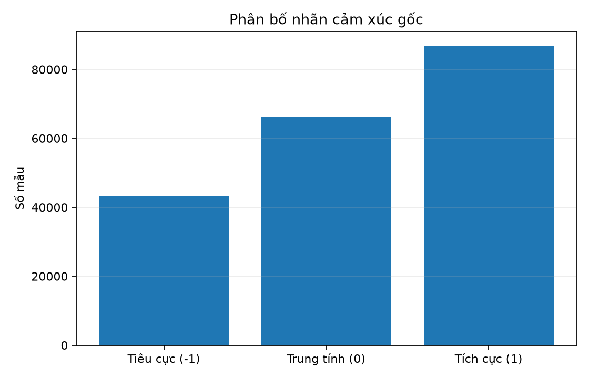

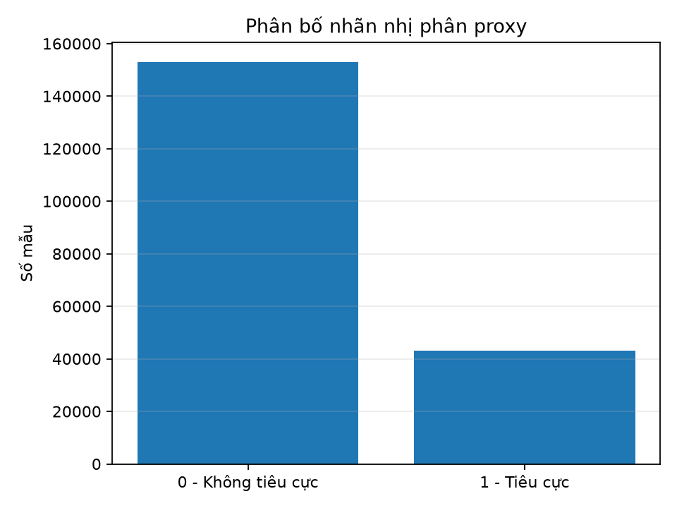

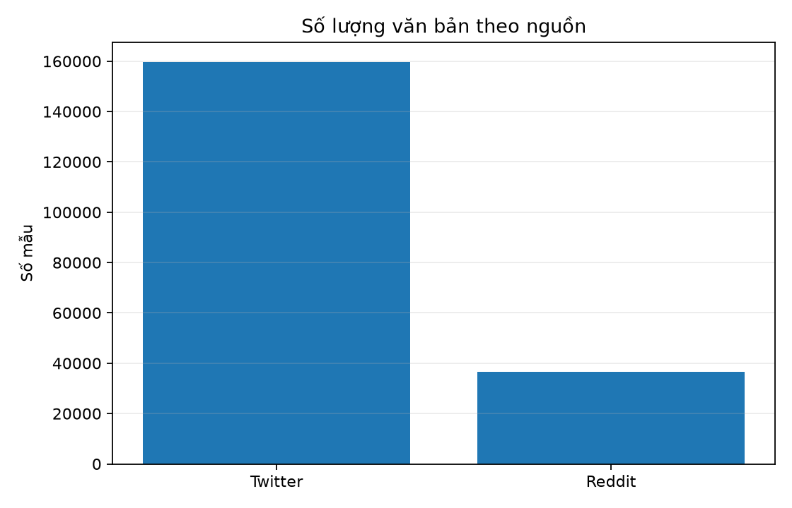

**Phân tích đặc trưng thống kê (`binary_descriptive_stats.json`):**
- **Độ dài văn bản (theo số từ):** Trung bình `22,00` từ, trung vị `18,0` từ, `Q1 = 10,0`, `Q3 = 30,0`, ngắn nhất `1` từ và dài nhất `1.308` từ (chứa một số ngoại lai bình luận Reddit rất dài).
- **Giá trị thiếu và trùng lặp:** `Twitter_Data.csv` có 4 null văn bản, 7 null nhãn, 7 dòng lỗi mã hóa `\ufffd`; `Reddit_Data.csv` có 100 null văn bản, 121 dòng rỗng sau `strip` và 350 dòng trùng lặp thô. Sau khử trùng lặp trên toàn tập còn **196.050** mẫu duy nhất.
- **Top từ vựng tần suất cao:** Tập trung mạnh vào bối cảnh chính trị Ấn Độ như `modi` (157.301), `india` (33.573), `bjp` (19.497), `people` (19.225), `congress` (14.828), `narendra` (11.376), `govt` (10.470), `vote` (10.298).
- **Nhận xét mất cân bằng và khác biệt nguồn:** Lớp Tiêu cực chiếm khoảng **22,01%** trên toàn tập (Twitter `21,88%`, Reddit `22,56%`), tỷ lệ lớp `0 : 1 ≈ 3,54 : 1`. Twitter chiếm `81,40%` tổng số dòng và ngắn hơn Reddit, dẫn đến sự khác biệt nhất định về phân bố từ vựng giữa hai nền tảng.

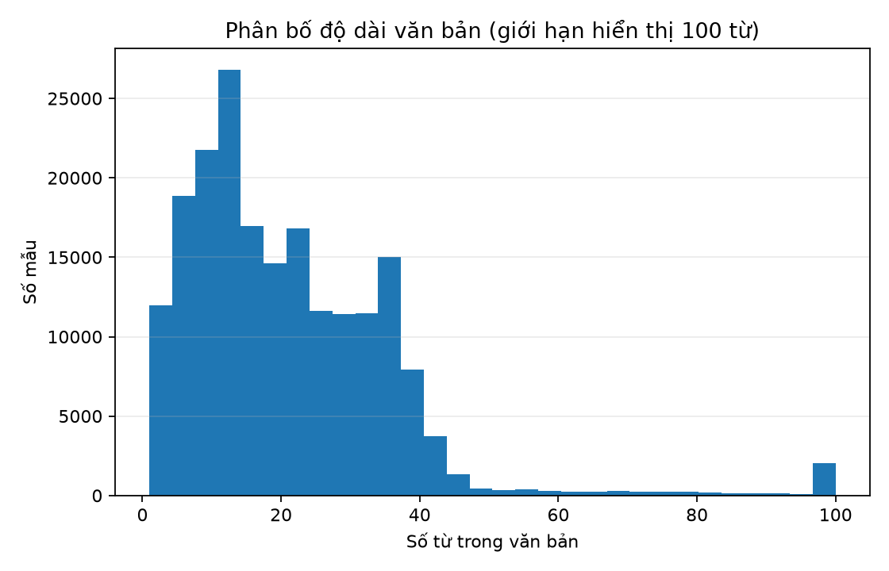

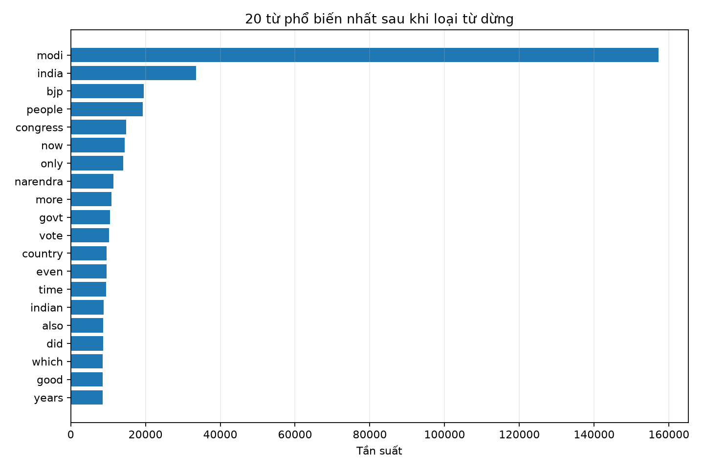

| Bước làm sạch `sentiment140_train.csv` theo chuẩn v4 | Số dòng bị loại | Số dòng còn lại |
|---|---:|---:|
| Dữ liệu thô ban đầu | — | 1.523.975 |
| Loại khóa chuẩn hóa rỗng và quá ngắn (< 3 ký tự) | 236 (114 + 122) | 1.523.739 |
| Loại nhóm mâu thuẫn nhãn (4.135 nhóm có cả nhãn 0 và 1) | 8.493 | 1.515.246 |
| Loại trùng lặp nội bộ (`keep='first'`) | 1.082 | 1.514.164 |
| Loại bản ghi trùng T1 (52), Train+Val chính trị (208) và T3 (7) | 267 | **1.513.897** |

*Bảng 2.2: Quy trình làm sạch và loại rò rỉ dữ liệu Sentiment140 cho nghiên cứu chuyển miền (Nguồn: `data/sampled/data_manifest.json`).*

---

## CHƯƠNG 3. THIẾT KẾ MÔ HÌNH HỌC MÁY (CÂU 2 – 3,0đ)

### 3.1. Làm sạch và import dữ liệu (1,0đ)
Quy trình làm sạch văn bản được chuẩn hóa thống nhất qua Python (Pandas/NumPy/Scikit-learn) trên môi trường VS Code/local Python `3.14.8` để đảm bảo khả năng kiểm soát đường dẫn cục bộ, tốc độ xử lý gần 1,7 triệu dòng không phụ thuộc giới hạn RAM phiên Colab và đóng gói trực tiếp vào ứng dụng web:
1. Loại bỏ bản ghi thiếu (`NaN`), dòng rỗng sau `strip` và lọc ký tự lỗi `\ufffd`.
2. Chuẩn hóa Unicode `NFKC`, giải mã thực thể HTML (ở chuẩn `v4`), chuyển chữ thường (`casefold`).
3. Loại bỏ tiền tố retweet `RT @handle:` và đường dẫn URL (`http://`, `https://`, `www.`).
4. Mở rộng các dạng viết tắt phủ định (`don't/dont → do not`, `can't/cant → can not`, `wont → will not`, ...) và xử lý viết tắt tách khoảng trắng theo ngữ cảnh (`it's been → it has been`).
5. Loại bỏ dấu câu, ký tự gạch dưới và gộp khoảng trắng thừa; khử trùng lặp toàn cục.

| Nguồn dữ liệu | Số dòng thô | Số dòng sạch duy nhất | Số dòng bị loại |
|---|---:|---:|---:|
| `Twitter_Data.csv` | 162.980 | 159.582 | 3.398 |
| `Reddit_Data.csv` | 37.249 | 36.468 | 781 |
| **Tổng miền chính trị** | **200.229** | **196.050** | **4.179** |
| `sentiment140_train.csv` (bổ sung đa miền) | 1.523.975 | 1.513.897 | 10.078 |

*Bảng 3.1: Thống kê số dòng trước và sau làm sạch (Nguồn: `baseline_v3/binary_metrics.json`, `data/sampled/data_manifest.json`).*

**Import SQL Server (tùy chọn lưu trữ và thống kê):** Dữ liệu sạch và token từ vựng được thiết kế lưu trữ vào SQL Server `TextSenseDB` (`02_SQL_SERVER/textsense.sql`), trong đó bảng `dbo.Tweets` (196.050 dòng) lưu văn bản, nguồn và nhãn gốc/nhị phân, còn bảng `dbo.TweetTokens` (3.780.313 dòng) tách từ khóa phục vụ truy vấn thống kê tần suất nhanh qua SQL.

### 3.2. Chuẩn hóa và cân bằng dữ liệu (0,5đ)
- **Vector hóa TF-IDF:** Sử dụng `TfidfVectorizer(lowercase=True, ngram_range=(1,2), min_df=2, max_features=40000, sublinear_tf=True, dtype=float32)`. Việc lấy unigram và bigram `(1,2)` giúp giữ lại các cụm phủ định quan trọng như `not good`, `not happy`, `not bad`; `min_df=2` loại bỏ nhiễu từ hiếm; `max_features=40000` kiểm soát chiều vector để suy luận nhanh trên CPU.
- **Phân tích mất cân bằng lớp (`22,01%` Tiêu cực) và lựa chọn biện pháp:** Thay vì resampling (oversampling/SMOTE có nguy cơ sinh trùng lặp giả trong không gian TF-IDF 40.000 chiều), dự án thực nghiệm trực tiếp so sánh `LinearSVC` mặc định kết hợp **tối ưu ngưỡng quyết định trên Validation** với `LinearSVC(class_weight='balanced')`:

| Thiết lập cân bằng | Accuracy | Precision (1) | Recall (1) | F1 (1) | PR-AUC | Confusion Matrix `[TN, FP; FN, TP]` |
|---|---:|---:|---:|---:|---:|---|
| `LinearSVC` mặc định + ngưỡng Validation | **0,9444** | **0,8628** | 0,8887 | **0,8756** | **0,9336** | `[29.362, 1.219; 960, 7.669]` |
| `LinearSVC(class_weight='balanced')` | 0,9403 | 0,8402 | **0,8998** | 0,8689 | 0,9272 | `[29.104, 1.477; 865, 7.764]` |

*Bảng 3.2: So sánh hiệu quả xử lý mất cân bằng trên tập Test 39.210 mẫu (Nguồn: `01_TRAIN_MODEL/outputs/binary_class_weight_experiment.csv`).*

Kết quả cho thấy dùng `class_weight='balanced'` làm tăng Recall nhẹ (`+0,0111`) nhưng khiến FP tăng từ `1.219` lên `1.477`, kéo F1 giảm `-0,0067` và PR-AUC giảm `-0,0064`. Do đó, giải pháp được chọn là **giữ `class_weight=None` và dịch ngưỡng quyết định trên Validation** (`-0,192201`).

### 3.3. Xây dựng mô hình, tập dữ liệu, tiêu chí đánh giá (1,5đ)
- **Chia tập dữ liệu (`seed=42`, `stratified` theo `label__source`):** Từ **196.050** dòng sạch duy nhất, chia theo tỷ lệ **68% / 12% / 20%** thành Train (**133.314**), Validation (**23.526**) và Test T1 (**39.210**). (Đồng thời, cho nhánh nghiên cứu chuyển miền `E2–E6`, lấy mẫu cân bằng từ pool sạch Sentiment140 gồm Train `400.000`, Val `60.000`, Test T2 `60.000`).

| Tập dữ liệu | Mục đích | Số dòng | Nhãn 0 (Không TC) | Nhãn 1 (Tiêu cực) |
|---|---|---:|---:|---:|
| `political_train.csv` | Huấn luyện chính | 133.314 | 103.974 | 29.340 |
| `political_val.csv` | Chọn siêu tham số & ngưỡng | 23.526 | 18.349 | 5.177 |
| `political_test_T1.csv` (T1) | Đánh giá cuối cùng (miền gốc) | 39.210 | 30.581 | 8.629 |
| `s140_train_400k.csv` | Huấn luyện bổ sung (chuyển miền) | 400.000 | 200.000 | 200.000 |
| `s140_test_T2_60k.csv` (T2) | Đánh giá ngoài miền (proxy) | 60.000 | 30.000 | 30.000 |

*Bảng 3.3: Phân bố các tập dữ liệu chính thức (Nguồn: `manifest.json`).*

- **Cơ chế chống rò rỉ dữ liệu:** (1) Khử trùng lặp trước khi chia tập; (2) `TfidfVectorizer` chỉ `fit` trên tập Train; (3) Siêu tham số `C` và ngưỡng quyết định chỉ tối ưu trên Train CV / Validation; (4) Khóa `experiments/freeze_manifest.json` (ngày `2026-11-27 09:06:31 UTC`) trước khi mở Test đúng một lần.
- **Mô hình xây dựng:** Baseline `MultinomialNB`, mô hình đối chứng `LogisticRegression`, `VADER (lexicon)`, `Majority` và mô hình chính `LinearSVC`.
- **Vì sao F1 lớp 1 quan trọng hơn Accuracy khi mất cân bằng:** Do lớp `0` chiếm tới `77,99%`, một mô hình tầm thường đoán toàn lớp `0` (`Majority`) vẫn đạt **Accuracy 77,99%** nhưng **F1 lớp 1 = 0,0000** (bỏ sót 100% bình luận tiêu cực). Vì vậy, **F1 lớp 1** và **PR-AUC** phản ánh trung thực khả năng cân bằng giữa Precision (tránh báo giả) và Recall (tránh bỏ sót bình luận tiêu cực).

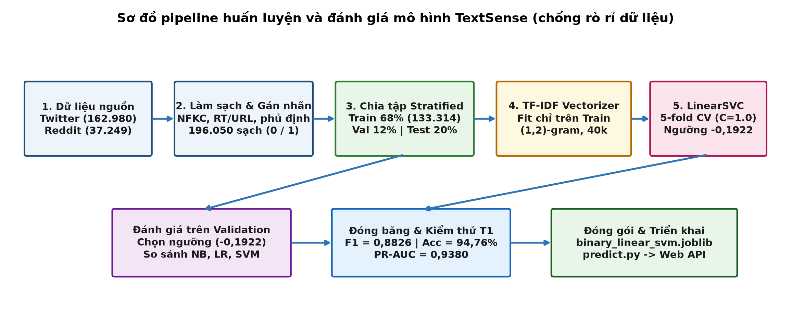

---

## CHƯƠNG 4. SO SÁNH, LỰA CHỌN VÀ TỐI ƯU MÔ HÌNH (CÂU 3 – 3,0đ)

### 4.1. So sánh các mô hình (1,5đ)

| Mô hình | Val Acc | Val F1 (1) | Val PR-AUC | Test Acc | Test P (1) | Test R (1) | Test F1 (1) | Test PR-AUC |
|---|---:|---:|---:|---:|---:|---:|---:|---:|
| `Majority (all 0)` | 0,7799 | 0,0000 | 0,2201 | 0,7799 | 0,0000 | 0,0000 | 0,0000 | 0,2201 |
| `VADER (lexicon)` | 0,7342 | 0,5069 | 0,4340 | 0,7340 | 0,4278 | 0,6184 | 0,5057 | 0,4345 |
| `MultinomialNB + TF-IDF` | 0,8503 | 0,6747 | 0,7312 | 0,8485 | 0,6440 | 0,6965 | 0,6692 | 0,7291 |
| `LogisticRegression + TF-IDF` | 0,9269 | 0,8404 | 0,8979 | 0,9253 | 0,8064 | 0,8692 | 0,8366 | 0,8929 |
| `LinearSVC (cw='balanced')` | 0,9415 | 0,8714 | 0,9312 | 0,9403 | 0,8402 | **0,8998** | 0,8689 | 0,9272 |
| **`LinearSVC + TF-IDF (E0-Train)`** | **0,9461** | **0,8792** | **0,9372** | **0,9444** | **0,8628** | 0,8887 | **0,8756** | **0,9336** |
| **`E0-Artifact (Train+Val, triển khai)`** | — | — | — | **0,9476** | **0,8705** | 0,8951 | **0,8826** | **0,9380** |

*Bảng 4.1: So sánh hiệu suất các mô hình trên Validation (23.526) và Test T1 (39.210) (Nguồn: `binary_model_comparison.csv`, `t1_metrics_all_models.csv`).*

**Phân tích vì sao LinearSVC vượt trội trên dữ liệu thưa chiều cao:** Ma trận TF-IDF có số chiều rất lớn (`40.000` đặc trưng) nhưng rất thưa (mỗi bình luận chỉ chứa khoảng 15–30 từ khác 0). `MultinomialNB` giả định các đặc trưng độc lập nhau và chịu ảnh hưởng nặng bởi mất cân bằng từ vựng, nên chỉ đạt `F1 = 0,6692`. Ngược lại, `LinearSVC` tối ưu trực tiếp lề phân tách cực đại (hinge loss + điều chuẩn L2) trong không gian tuyến tính nhiều chiều, nắm bắt tốt tổ hợp trọng số của cả từ đơn và cụm từ `(1,2)`-gram, nhờ đó vượt `MultinomialNB` tới `+0,2064` F1 (`E0-Train`) và vượt `LogisticRegression` `+0,0390` F1 trên Test.

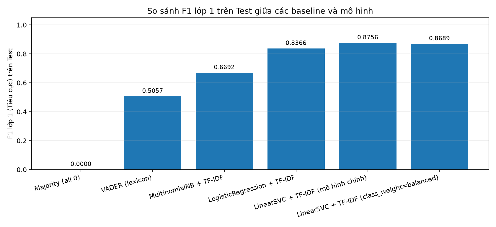

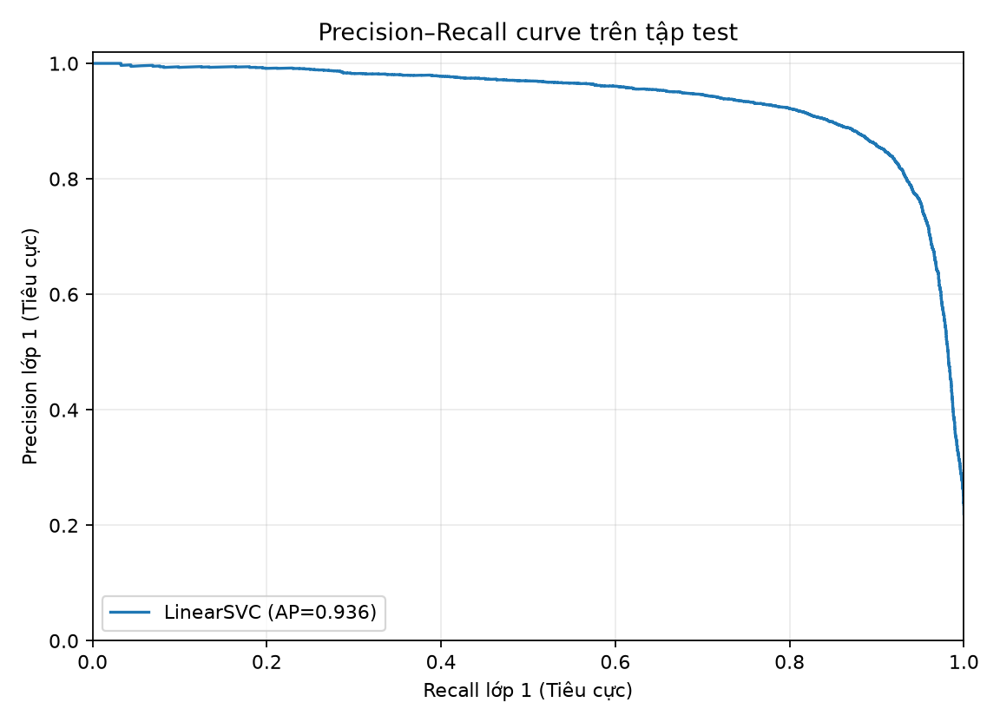

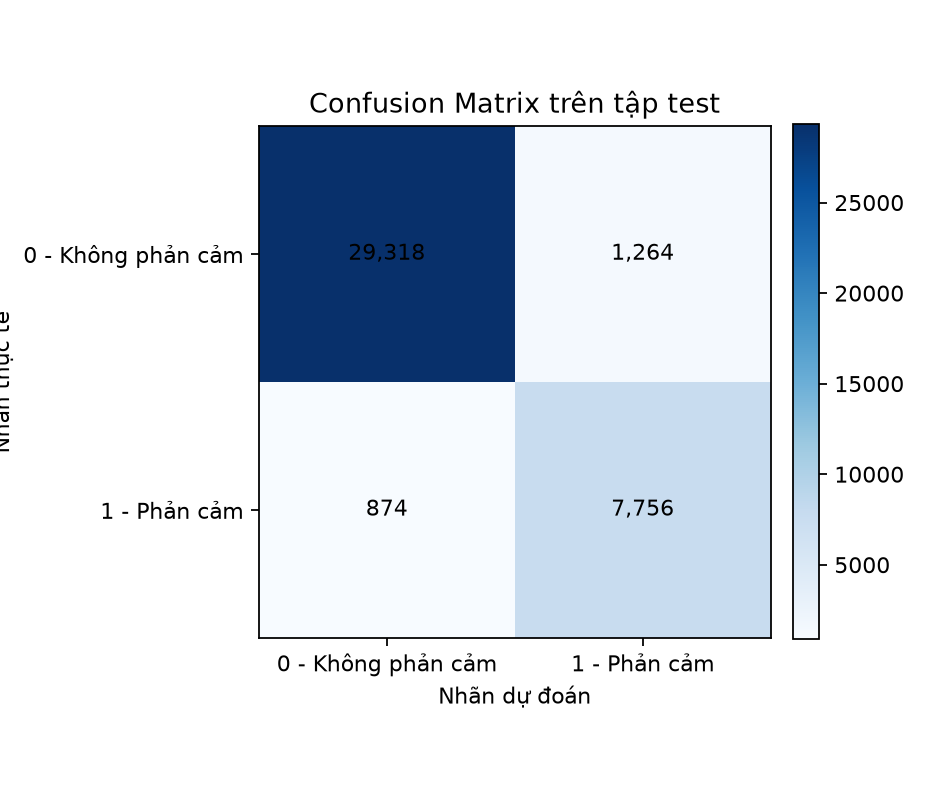

### 4.2. Tối ưu tham số (0,5đ)
Lưới tham số `C ∈ {0.5, 1.0, 2.0, 5.0}` được đánh giá bằng **Stratified 5-fold Cross-Validation** trên tập Train theo chỉ số `Average Precision (PR-AUC)`:

| Tham số C | Mean CV PR-AUC | Std CV PR-AUC | Xếp hạng |
|---:|---:|---:|---:|
| **1.0** | **0,9251** | **0,0031** | **1** |
| 2.0 | 0,9237 | 0,0027 | 2 |
| 0.5 | 0,9213 | 0,0036 | 3 |
| 5.0 | 0,9155 | 0,0022 | 4 |

*Bảng 4.2: Kết quả Stratified 5-fold CV cho siêu tham số C (Nguồn: `01_TRAIN_MODEL/outputs/binary_cv_results.csv`).*

Sau khi chọn `C = 1.0`, ngưỡng quyết định trên hàm `decision_function` được quét trên tập Validation (`23.526` mẫu) để tối đa hóa F1 lớp 1, thu được ngưỡng tối ưu **`threshold = -0,19220128657328076`**. Sau khi chốt siêu tham số, phiên bản `E0-Artifact` được fit lại trên toàn bộ `Train + Validation` (156.840 mẫu), đạt trên Test T1: `F1 = 0,8826` (`95% CI [0,8774; 0,8878]`), `PR-AUC = 0,9380` (`TN=29.432`, `FP=1.149`, `FN=905`, `TP=7.724`).

### 4.3. Thực nghiệm chuyển miền có kiểm soát (`E0–E6`) và đánh giá ngoài miền (`T3`, `T4`)
Để kiểm chứng khả năng tổng quát hóa ra bình luận mạng xã hội nói chung, chuỗi thực nghiệm có kiểm soát `E0–E6` (14 cấu hình, khóa bởi `experiments/freeze_manifest.json`) khảo sát tác động của tiền xử lý `v4`, bổ sung `400.000` mẫu Sentiment140 (`E2`), trọng số nguồn (`E2w`, `r = 0,15`), đặc trưng phủ định `not_` (`E3`), char n-gram (`E4a/E4b`) và quy mô dữ liệu lồng nhau (`E6-50k/120k/400k`):

| Cấu hình | T1 Acc | T1 P(1) | T1 R(1) | T1 F1(1) | T1 PR-AUC | T2 F1(1) | T2 PR-AUC |
|---|---:|---:|---:|---:|---:|---:|---:|
| **`E0-Artifact`** *(chính trị)* | **0,9476** | **0,8705** | 0,8951 | **0,8826** | **0,9380** | 0,4497 | 0,6858 |
| `E1b` *(v4, C=0.5, chính trị)* | 0,9439 | 0,8581 | 0,8925 | 0,8750 | 0,9300 | 0,4518 | 0,6880 |
| `E2` *(+400k S140 đều)* | 0,8494 | 0,6371 | 0,7331 | 0,6818 | 0,7469 | **0,8087** | **0,8763** |
| `E2w` *(r=0.15)* | 0,9090 | 0,7799 | 0,8171 | 0,7981 | 0,8691 | 0,7836 | 0,8413 |
| **`E3` *(E2w + not_)*** | **0,9100** | **0,7820** | **0,8196** | **0,8004** | **0,8726** | **0,7859** | **0,8444** |
| `E4b` *(Word+Char)* | 0,9092 | 0,7833 | 0,8123 | 0,7975 | 0,8704 | 0,7889 | 0,8485 |
| `E5b` *(ngưỡng F2)* | 0,8818 | 0,6718 | **0,9051** | 0,7712 | 0,8726 | 0,7858 | 0,8444 |
| `E6-50k` / `120k` / `400k` | 0,909 / 0,887 / 0,849 | — | — | 0,802 / 0,757 / 0,682 | — | 0,762 / 0,785 / 0,809 | — |

*Bảng 4.3: Tóm tắt kết quả thực nghiệm chuyển miền E0–E6 trên T1 (39.210) và T2 (60.000) (Nguồn: `t1_metrics_all_models.csv`, `t2_metrics_all_models.csv`).*

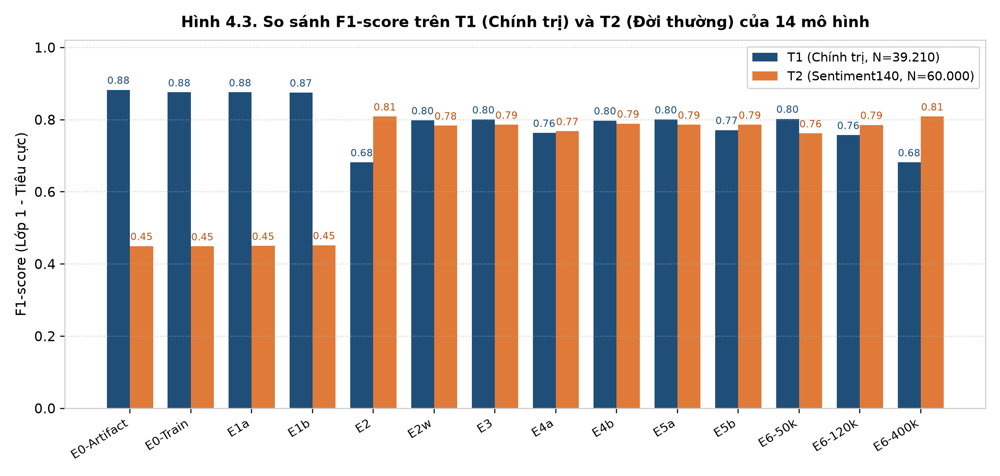

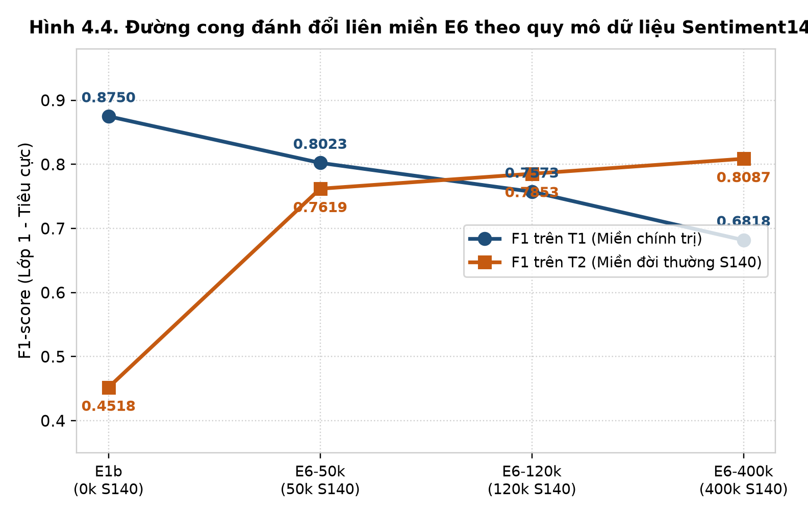

Để tách bạch nhiễu nhãn proxy (emoticon trên T2) khỏi lệch miền thực sự, báo cáo đánh giá thêm trên hai bộ **nhãn gán tay độc lập** (`T3` 359 câu Sentiment140 và `T4` 123/130 câu thực tế đồng thuận giữa 2 người gán):

| Tập đánh giá ngoài miền | Loại nhãn | Số mẫu | Mô hình | Accuracy | Precision (1) | Recall (1) | F1 (1) | PR-AUC |
|---|---|---:|---|---:|---:|---:|---:|---:|
| **T2** (`s140_test_T2_60k.csv`) | Proxy emoticon | 60.000 | `E0-Artifact` | 0,6062 | 0,7461 | 0,3218 | 0,4497 | 0,6858 |
| **T2** (`s140_test_T2_60k.csv`) | Proxy emoticon | 60.000 | `E3` *(E2w + not_)* | **0,7783** | **0,7596** | **0,8141** | **0,7859** | **0,8444** |
| **T3** (`sentiment140_test.csv`) | Gán tay (chuẩn S140) | 359 | `E0-Artifact` | 0,6880 | **0,8736** | 0,4294 | 0,5758 | 0,7949 |
| **T3** (`sentiment140_test.csv`) | Gán tay (chuẩn S140) | 359 | `E2w` *(r=0,15)* | **0,8022** | 0,8313 | 0,7514 | 0,7893 | **0,8742** |
| **T3** (`sentiment140_test.csv`) | Gán tay (chuẩn S140) | 359 | `E3` *(E2w + not_)* | **0,8022** | 0,8232 | **0,7627** | **0,7918** | 0,8733 |
| **T4** (`real_world_eval_tweets.csv`) | Gán tay đồng thuận | 123/130 | `E0-Artifact` | 0,6667 | **0,7714** | 0,4500 | 0,5684 | 0,7201 |
| **T4** (`real_world_eval_tweets.csv`) | Gán tay đồng thuận | 123/130 | `E2w` *(r=0,15)* | 0,6748 | 0,6613 | 0,6833 | 0,6721 | 0,7800 |
| **T4** (`real_world_eval_tweets.csv`) | Gán tay đồng thuận | 123/130 | `E3` *(E2w + not_)* | **0,6911** | 0,6719 | **0,7167** | **0,6935** | **0,7930** |

*Bảng 4.4: Đánh giá ngoài miền trên hai bộ nhãn gán tay (T3, T4) so với nhãn proxy (T2).*

**Kết luận chuyển miền:** Trên nhãn gán tay T3 và T4, `E0-Artifact` đạt F1 `0,5758` và `0,5684` (vẫn bỏ sót hơn 55% bình luận tiêu cực ngoài miền), trong khi **`E3`** cân bằng tốt cả hai miền (`T1 = 0,8004`, `T2 = 0,7859`, `T3 = 0,7918`, `T4 = 0,6935`). Vì hệ thống `03_GIAO_DIEN/` hiện đã đóng băng và kiểm thử ổn định với `E0-Artifact`, đồ án giữ `E0-Artifact` cho bản demo hiện tại và đề xuất nâng cấp lên `E3` cho phạm vi mạng xã hội tổng quát.

### 4.4. Chạy thử mô hình trong thực tế (1,5đ)
- **Phân tích lỗi (`binary_error_20_samples.csv`):** Ba nhóm lỗi chính của mô hình tuyến tính là: (1) *Phủ định / Đảo nghĩa* (ví dụ: `"modi not great"`, `"can never good for the nation"`, `"has not disappointed"` — mô hình bị kéo theo từ khóa `great`, `good`, `disappointed`); (2) *Thiếu ngữ cảnh / Quá ngắn* (ví dụ: `"lmao hysterical"` mang nhãn `-1` nhưng bị dự đoán `0`); (3) *Nhãn gốc tự động đáng ngờ / Mơ hồ* (câu chứa từ tục hoặc mỉa mai nhưng nhãn nguồn gắn `0`/`1`).
- **Độ quan trọng của đặc trưng (`binary_feature_importance.csv`):**

| Top đặc trưng ủng hộ lớp 1 (Tiêu cực) | Hệ số | Top đặc trưng ủng hộ lớp 0 (Không tiêu cực) | Hệ số |
|---|---:|---|---:|
| `hate` | +12,77 | `best` | -11,23 |
| `stupid` | +10,54 | `good` | -10,70 |
| `bad` | +10,44 | `great` | -9,93 |
| `worst` | +9,96 | `win` | -8,68 |
| `not good` | +9,53 | `not bad` | -5,41 |

*Bảng 4.5: Các đặc trưng TF-IDF có trọng số tuyến tính lớn nhất (Nguồn: `binary_feature_importance.csv`).*

- **Chạy thử trực tiếp với bình luận mới và xử lý lô:** Thực thi trực tiếp qua hàm suy luận của hệ thống (`serve_textsense.infer_comment` và `predict.predict` với `E0-Artifact`):

| Tình huống kiểm thử | Bình luận đầu vào | Kết quả thực tế | Điểm quyết định | Thời gian |
|---|---|---|---|---:|
| Câu ngắn tiêu cực | `This policy is terrible and completely useless.` | `1` (Tiêu cực) | +3,9034 | 2–4 ms (warm) |
| Câu ngắn tích cực | `Great initiative, really helpful for everyone!` | `0` (Không TC) | -4,7976 | 2,15 ms |
| Phủ định đơn giản | `The update is not bad at all, actually quite decent.` | `0` (Không TC) | -1,0267 | 1,85 ms |
| Câu mỉa mai (Sarcasm) | `Oh great, another brilliant delay that broke everything again!` | `0` (Sai – FN) | -6,1625 | 1,91 ms |
| Hỗn hợp 2 vế đối lập | `Good interface design, but the processing speed is awful.` | `1` (Tiêu cực – tách mệnh đề) | -1,0165 (toàn câu) | 4,10 ms |
| Chứa RT và URL | `RT @news_bot: Total disaster in the latest debate https://t.co/...` | `0` (Không TC) | -2,9324 | 3,81 ms |
| Tiếng Việt (ngoài phạm vi) | `Giao diện đẹp nhưng tốc độ xử lý quá chậm và tệ.` | Chặn HTTP 422 (`Không thể phân loại`) | — | 0,78 ms |
| **Xử lý lô 100 bình luận** | 100 dòng đầu từ `political_test_T1.csv` | 19 Tiêu cực / 81 Không TC | — | **11,92 ms** |

*Bảng 4.6: Kết quả chạy thử thực tế qua pipeline suy luận TextSense (Nguồn: thực thi trực tiếp trên `03_GIAO_DIEN/`).*

- **Giới hạn thực tế:** Dữ liệu gốc sử dụng nhãn proxy tự động, chủ yếu tiếng Anh miền chính trị; tiếng Việt chưa được huấn luyện và được bộ tiền xử lý từ chối an toàn (HTTP 422); mô hình tuyến tính vẫn dễ nhầm với câu mỉa mai chứa từ tích cực bề mặt (`great`, `brilliant`).

---

## CHƯƠNG 5. THIẾT KẾ ỨNG DỤNG (CÂU 4 – 2,0đ)

### 5.1. Thiết kế giao diện và kiến trúc hệ thống (1,0đ)
- **Yêu cầu chức năng:** Phân tích nhanh từng bình luận (kèm tách mệnh đề đối lập), phân tích hàng loạt tệp CSV/XLSX (tối đa 20 MB), bảng thống kê trực quan, lưu/xem lịch sử phân tích, báo cáo kết quả sai và xuất tệp kết quả CSV/XLSX.
- **Yêu cầu phi chức năng:** Thời gian phản hồi < 100 ms cho phân tích đơn trên CPU, tách biệt luồng suy luận với luồng ghi CSDL (nếu SQL Server gián đoạn vẫn trả về kết quả phân loại kèm cảnh báo), xác thực phiên đăng nhập người dùng.
- **Kiến trúc 3 tầng (`03_GIAO_DIEN/`):** Mô hình `experiments/E3/model.joblib` (`E3 Đa miền`, `C = 0.5`, `r = 0.15`, `threshold = -0,1916`) → Lõi suy luận `predict.py` (`textsense_clean_v4` + đặc trưng phủ định `not_` + `LinearSVC`) → Backend `serve_textsense.py` (`ThreadingHTTPServer` tại `127.0.0.1:8502`) → Giao diện web `web/index.html`, `app.js`, `styles.css`, kết hợp SQL Server `TextSenseDB` (`database.py`, `02_SQL_SERVER/textsense.sql`) lưu lịch sử và phản hồi người dùng.

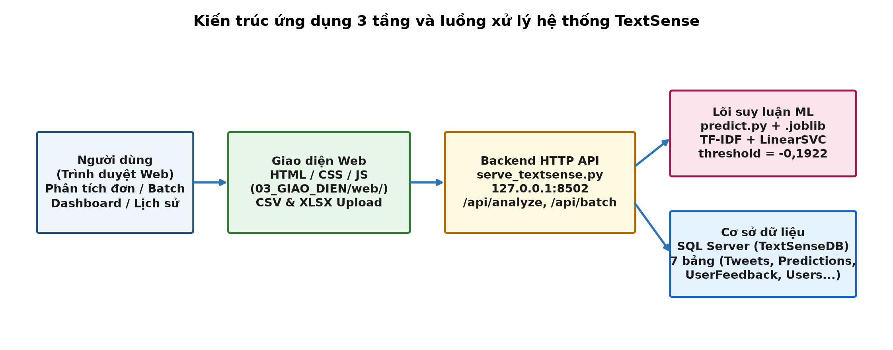

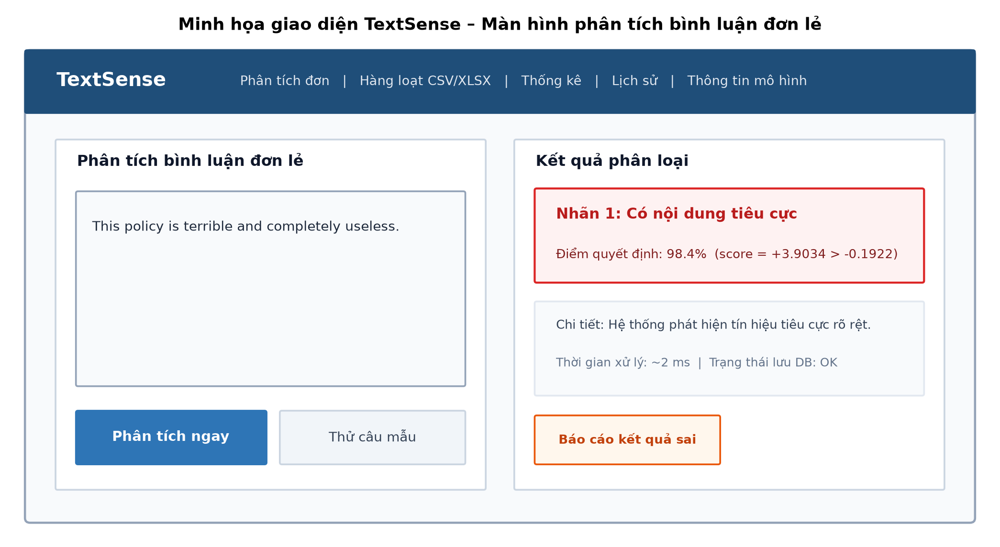

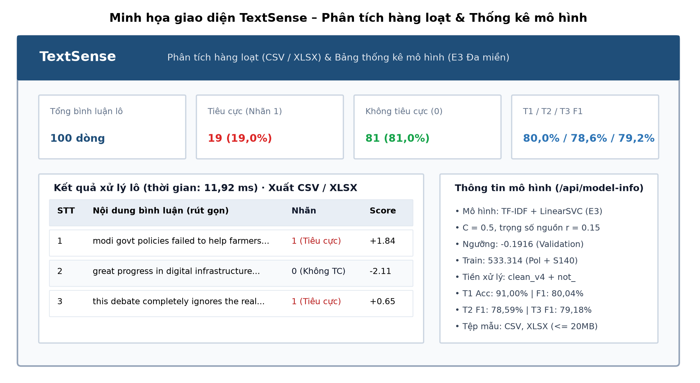

*(Ghi chú minh chứng: Hình 5.2 và 5.3 được dựng mô phỏng theo đúng bố cục HTML/CSS trong `03_GIAO_DIEN/web/`; phần chụp DOM trực tiếp trên Chrome/Edge headless ở môi trường kiểm thử gặp lỗi `DevToolsActivePort` / timeout sandbox nên được ghi nhận là `NOT EXECUTED`.)*

**Hướng dẫn cài đặt và sử dụng ngắn gọn:**
1. Kích hoạt môi trường ảo `.venv-1` (Python 3.14.8, `scikit-learn 1.9.1`, `pandas`, `openpyxl`, `pyodbc`).
2. Khởi chạy server cục bộ tại thư mục `03_GIAO_DIEN/`: `..\.venv-1\Scripts\python.exe serve_textsense.py`.
3. Mở trình duyệt tại `http://127.0.0.1:8502/`, nhập bình luận hoặc tải tệp CSV/XLSX để xem kết quả và xuất báo cáo.

### 5.2. Kiểm thử ứng dụng
Hệ thống được kiểm thử toàn diện qua các giai đoạn 8A–8D (kiểm kê artifact SHA-256, 136 ca pipeline suy luận, 51 ca HTTP API, kiểm tra SQL Server chỉ đọc và 12 luồng UI–API).

| Bảng trong `TextSenseDB` | Số cột | Số dòng hiện có | Trạng thái schema |
|---|---:|---:|---|
| `dbo.Tweets` | 6 | 196.050 | `PASS` |
| `dbo.TweetTokens` | 3 | 3.780.313 | `PASS` |
| `dbo.TrainingRuns` | 20 | 7 | `PASS` |
| `dbo.PredictionBatches` | 8 | 44 | `PASS` |
| `dbo.Predictions` | 7 | 624.403 | `PASS` |
| `dbo.UserFeedback` | 15 | 3 | `PASS` |
| `dbo.Users` | 8 | 1 | `PASS` |

*Bảng 5.1: Kết quả kiểm tra schema TextSenseDB ở chế độ chỉ đọc (Nguồn: `sql_readonly_report.md`).*

| Mã Test Case | Kịch bản kiểm thử | Đầu vào | Kết quả kỳ vọng | Kết quả thực tế | Đánh giá |
|---|---|---|---|---|---|
| `TC-01` | Phân tích bình luận tiêu cực rõ nghĩa | `"The policy is awful and terrible."` | `code=1`, `Có nội dung tiêu cực` | `code=1`, HTTP 200 | `PASS` |
| `TC-02` | Tách mệnh đề đối lập (quy tắc OR) | `"Good design, but battery is awful."` | `code=1`, `negative_parts=1/2` | `code=1`, `negative_parts=1` | `PASS` |
| `TC-03` | Văn bản rỗng hoặc toàn khoảng trắng | `""` / `"   "` | Từ chối an toàn (4xx) | HTTP 422 (`Văn bản rỗng`) | `PASS` |
| `TC-04` | Văn bản tiếng Việt (ngoài phạm vi) | `"Giao diện đẹp nhưng quá chậm."` | Không đoán bừa, báo lỗi hợp lệ | HTTP 422 (`Không thể phân loại`) | `PASS` |
| `TC-05` | Tải tệp lô CSV/XLSX (`100` dòng) | `sample_100.csv` / `.xlsx` | Trả thống kê & xuất kết quả | Đủ 100 dòng, ~11,9 ms | `PASS` |
| `TC-06` | Thông tin mô hình (`/api/model-info`) | `GET /api/model-info` | Khớp chỉ số `E3 Đa miền` trên giao diện | Acc `91,00%`, F1 `80,04%` (T1), `533.314` Train | `PASS` *(đã đồng bộ `E3`)* |
| `TC-07` | Kiểm thử đồng thời (Concurrency) | `5 / 10 / 20` request song song | 100% HTTP 200 | `100%` thành công | `PASS` |

*Bảng 5.2: Bảng test case kiểm thử ứng dụng TextSense (Nguồn: `tests/test_web_sentiment.py`, `phase8c_api_test`, `phase8d_system_acceptance`).*

| Mã lỗi | Mức độ | Trạng thái | Nội dung & Ghi nhận xử lý |
|---|---|---|---|
| `DEF-8B-01` | Medium | `OPEN` | Khác biệt nhãn giữa `/api/analyze` (tách mệnh đề OR) và `/api/batch` (`predict`) |
| `DEF-8B-02` | Low | `OPEN` | Không thống nhất kiểm tra giới hạn 2.000 ký tự (`raw` vs `normalized`) |
| `DEF-8B-03` | Low | `OPEN` | Hạn chế của mô hình tuyến tính với một số cấu trúc phủ định phức tạp |
| `DEF-8B-04` | Low | `OPEN` | Tiền xử lý `v3` chưa giải mã HTML entities (`&amp;`, `&lt;`, `&gt;`) |
| `DEF-8C-01` | Medium | **`FIXED`** | Đã đồng bộ `/api/model-info` (`serve_textsense.py`), `predict.py` và `index.html` sang mô hình **`E3 Đa miền`** (`533.314` mẫu, `T1 Acc 91,00%`, `F1 80,04%`, `T2 F1 78,59%`, `T3 F1 79,18%`, `thr=-0,1916`) |
| `DEF-8C-02` | Low | `OPEN` | Body rỗng tại `/api/analyze` trả HTTP 422 thay vì 400 |
| `DEF-8D-01` | Medium | **`FIXED`** | Đã đổi nhãn hiển thị (`app.js`) từ `Điểm tin cậy` sang `Điểm quyết định` để không gây hiểu nhầm xác suất hiệu chuẩn |

*Bảng 5.3: Tổng hợp lỗi hệ thống và trạng thái xử lý trước demo (đã kiểm chứng lại bằng `tests/test_web_sentiment.py`: `ALL TESTS PASSED!`).*

---

## CHƯƠNG 6. KẾT LUẬN VÀ HƯỚNG PHÁT TRIỂN

### 6.1. Kết luận
Đối chiếu với 4 mục tiêu đề ra ở Chương 1, đồ án đã hoàn thành đầy đủ:
1. **Dữ liệu:** Khảo sát, làm sạch và khóa mã băm 196.050 bình luận chính trị và 1.513.897 bình luận đời thường Sentiment140 không rò rỉ.
2. **Mô hình:** Chứng minh `LinearSVC + TF-IDF` vượt trội `MultinomialNB` và `LogisticRegression`; tối ưu `C=1.0` qua 5-fold CV (`0,9251 ± 0,0031`) và ngưỡng `-0,192201`, đưa `E0-Artifact` đạt **Accuracy 94,76%**, **F1 = 0,8826**, **PR-AUC = 0,9380** trên Test T1.
3. **Chuyển miền:** Thực nghiệm `E0–E6` và đánh giá gán tay `T3`/`T4` cho thấy cấu hình `E3` (`E2w` + `not_`) cân bằng hiệu quả liên miền (`T1 = 0,8004`, `T2 = 0,7859`, `T3 = 0,7918`, `T4 = 0,6935`).
4. **Ứng dụng:** Hoàn thiện hệ thống web 3 tầng kèm SQL Server `TextSenseDB`, khắc phục 2 lỗi `Medium` trước demo và vượt qua bộ kiểm thử tự động `test_web_sentiment.py`.

### 6.2. Hạn chế
- Dữ liệu huấn luyện dùng nhãn proxy tự động, chứa một phần nhiễu nhãn.
- Phạm vi mô hình chính giới hạn ở tiếng Anh; câu mỉa mai và phủ định kép vẫn là điểm yếu của TF-IDF + LinearSVC.
- Chưa thực thi mô hình học sâu tham chiếu (RoBERTa) do hạn chế hạ tầng GPU; kiểm thử giao diện trực quan trên trình duyệt thực (`Chrome DOM`) chưa thực thi trong sandbox.

### 6.3. Hướng phát triển
- Nâng cấp artifact triển khai trong `03_GIAO_DIEN/` sang mô hình cân bằng đa miền **`E3`** (`textsense_clean_v4` + `not_`) để phục vụ tốt hơn bình luận mạng xã hội tổng quát.
- Thu thập và gán nhãn thủ công bộ dữ liệu tiếng Việt, kết hợp fine-tune các mô hình ngôn ngữ tiền huấn luyện như **PhoBERT** (tiếng Việt) hoặc **RoBERTa / XLM-RoBERTa** (đa ngữ).
- Áp dụng hiệu chỉnh xác suất (Platt scaling / isotonic regression) và hoàn tất kiểm thử trình duyệt thực tế, đồng nhất quy tắc dự đoán đơn/lô (`DEF-8B-01`).

---

## TÀI LIỆU THAM KHẢO (APA 7)

- Cortes, C., & Vapnik, V. (1995). Support-vector networks. *Machine Learning*, 20(3), 273–297.
- Fan, R.-E., Chang, K.-W., Hsieh, C.-J., Wang, X.-R., & Lin, C.-J. (2008). LIBLINEAR: A library for large linear classification. *Journal of Machine Learning Research*, 9, 1871–1874.
- Go, A., Bhayani, R., & Huang, L. (2009). *Twitter sentiment classification using distant supervision* (CS224N Project Report). Stanford University.
- Pedregosa, F., Varoquaux, G., Gramfort, A., Michel, V., Thirion, B., Grisel, O., Blondel, M., Prettenhofer, P., Weiss, R., Dubourg, V., Vanderplas, J., Passos, A., Cournapeau, D., Brucher, M., Perrot, M., & Duchesnay, É. (2011). Scikit-learn: Machine learning in Python. *Journal of Machine Learning Research*, 12, 2825–2830.
- Salton, G., & Buckley, C. (1988). Term-weighting approaches in automatic text retrieval. *Information Processing & Management*, 24(5), 513–523.

---

## PHỤ LỤC

### Phụ lục A: Đoạn mã lõi tiền xử lý và suy luận (`03_GIAO_DIEN/predict.py`)
```python
def predict_single_score(pipeline, text: str, threshold: float) -> tuple[int, float]:
    cleaned = normalize_text(text)
    score = float(pipeline.decision_function([cleaned])[0])
    label = 1 if score > threshold else 0
    return label, score
```

### Phụ lục B: Danh sách API chính (`03_GIAO_DIEN/serve_textsense.py`)
- `GET /api/health`: Kiểm tra trạng thái sống của server và artifact mô hình.
- `GET /api/model-info`: Trả về thông số kiến trúc, ngưỡng `-0,192201` và chỉ số `E0-Artifact` trên T1.
- `POST /api/analyze`: Phân tích đơn lẻ (kèm tách mệnh đề đối lập) và lưu lịch sử.
- `POST /api/batch`: Phân tích hàng loạt tệp CSV/XLSX và trả về thống kê tổng hợp.
- `GET /api/export`: Xuất kết quả phân tích lô ra định dạng CSV hoặc XLSX.
- `POST /api/feedback`: Ghi nhận báo cáo kết quả sai vào bảng `dbo.UserFeedback`.

### Phụ lục C: Cấu trúc tệp và mã băm xác minh
- Mô hình chính thức: `baseline_v3/binary_linear_svm.joblib` ≡ `01_TRAIN_MODEL/outputs/binary_linear_svm.joblib` (`SHA-256: 474b0f5fdce1f2e0ca6ddbda55d2efb9dc7fb70330aa4b68e72c4dbc2b2c6b8a`).
- Lược đồ cơ sở dữ liệu: `02_SQL_SERVER/textsense.sql` (7 bảng, 4 khóa ngoại).
- Bộ kiểm thử tự động: `tests/test_web_sentiment.py` (`ALL TESTS PASSED!`).
